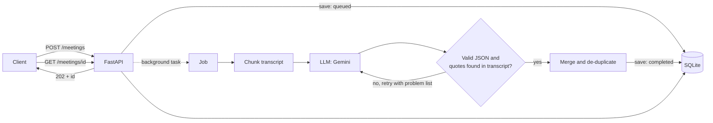

# Takeaway

Meeting transcripts in, owned and verifiable action items out.

Takeaway takes a meeting transcript and returns a summary, the decisions made, and action items
with an owner, a due date and the exact quote that supports each one. Every quote is checked
against the transcript, so an item the model made up is rejected instead of shown to the user.

> Status: the extraction pipeline, API, storage, tests and evaluation are done.
> Docker, a live deployment, CI and a demo are still to come.

## How it works



1. `POST /meetings` stores the job as `queued` and returns `202 Accepted` with an id straight away.
2. A background task splits long transcripts into overlapping chunks and asks the model for JSON
   on each chunk.
3. Each response is validated with Pydantic. Its `evidence` quotes must appear in the transcript.
   If validation fails, the model is called again with a short list of what was wrong (3 attempts).
4. Per-chunk results are merged and duplicates removed (same evidence quote means same item).
5. The result is saved. `GET /meetings/{id}` returns the status and, when done, the result.

Design choices worth knowing:

- The model's output schema is separate from the API and storage models.
- A failed job stores a generic error message. Details go to logs, not to the client.
- Storage sits behind `save_job` and `get_job`, so SQLite can be swapped for Postgres.
- The Gemini key is optional at import time, so tests and CI run with no secrets.

## Run it

Requires Python 3.12+ and [uv](https://docs.astral.sh/uv/).

```bash
uv sync
cp .env.example .env        # then add your GEMINI_API_KEY
uv run uvicorn app.main:app --reload
```

Open http://127.0.0.1:8000/docs, or from a terminal:

```bash
curl -X POST http://127.0.0.1:8000/meetings \
  -H "Content-Type: application/json" \
  -d '{"transcript": "Ravi: I'\''ll send the budget by Friday.", "meeting_date": "2026-10-27"}'
# -> {"id": "...", "status": "queued"}

curl http://127.0.0.1:8000/meetings/<id>
```

Run the extractor on a file without the API:

```bash
uv run python -m scripts.extract_file data/samples/standup_01.txt --date 2026-10-27
```

## Test it

```bash
uv run pytest -q
uv run ruff check
```

Tests never call the real model; the LLM is replaced by a fake.

## Evaluation

`data/eval/` holds 5 synthetic meetings, each with a transcript and an `.expected.json` of the
action items that should be found (27 in total). The traps are deliberate: ideas ("maybe we
could..."), deferred items ("let's park it"), vague meetings ("catch up soon"), corrected
deadlines, and tasks with no owner. Labelling rules are in `data/eval/README.md`.

```bash
uv run python -m scripts.evaluate              # all meetings (calls the real model)
uv run python -m scripts.evaluate --only planning_01
```

For each meeting the scorer matches extracted items to expected ones by their evidence quote,
then reports how many were found, how many were invented (matched nothing expected), and
whether the owner and due date were right.

Model: `gemini-3.5-flash-lite`. Results:

| Run | Found | Invented | Owner correct | Due date correct | Avg latency |
|---|---|---|---|---|---|
| v1 prompt | 23 / 27 (85%) | 0 | 23 / 23 | 21 / 23 | 4.9 s |
| + rules for vague deadlines and "next <weekday>" | 24 / 27 (89%) | 0 | 24 / 24 | 23 / 24 | 4.7 s |
| + dates resolved in code (one borderline label removed, 26 items) | 25 / 26 (96%) | 0 | 25 / 25 | 25 / 25 | 5.5 s |

What the remaining errors are:

- **Ownerless requests are found unreliably.** "Someone should email the client" is still
  missed, and which ownerless lines get caught has changed between runs.
- **Vague group aspirations are not extracted.** "We should investigate the performance issues
  soon" was labelled expected at first, then re-labelled as not an action item. That is a
  judgement call, made after seeing the model skip it, and the first two rows above were scored
  with it included (out of 27).
- **Date resolution is by quote, in code.** `app/dates.py` computes "today", "tomorrow", a
  weekday and "next <weekday>" from the evidence quote, because the model once resolved
  "next Wednesday" to the wrong week. The rule is a convention, and a quote that mentions a
  weekday for another reason ("Monday's meeting") or quotes a deadline that was later corrected
  can get the wrong date. Two different date phrases in one quote are skipped.

### Limits of these numbers

The meetings are synthetic, short, and were written together with their labels, so the labels
are ground truth by construction, not hand-labelled from real meetings. Five meetings is a small
sample and the model is not deterministic, so single runs vary by an item or two. Treat the
table as a regression check for prompt changes, not as a claim about real-world accuracy.
Cost per meeting is not measured yet.

## Not yet done

Docker image, live deployment, CI, demo GIF, token and cost tracking, retry on API errors
(rate limits, network), and a Postgres option.
